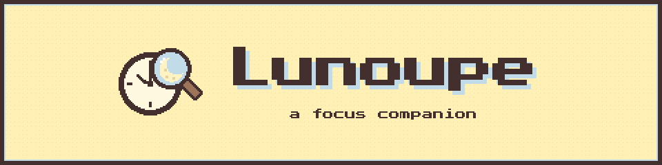
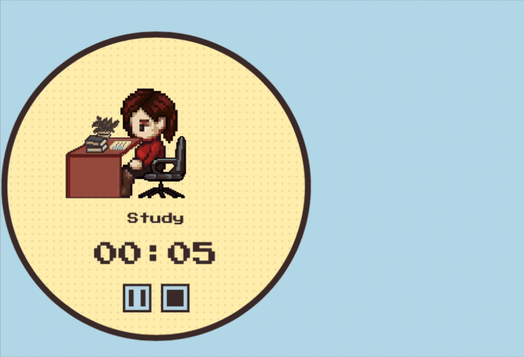

<p align="center">
  
</p>

<p align="center">
  <b>Little desk buddy that focuses and finishes your tasks with you.</b><br>
  For macOS and Windows · English and 한국어
</p>

<p align="center">
  <a href="https://echo5vgames.itch.io/lunoupe"><b>Get it on itch.io</b></a> ·
  <a href="https://github.com/arjrst/lunoupe/releases/latest"><b>Download from GitHub</b></a>
</p>

<p align="center">
  
</p>

## What is Lunoupe?

Lunoupe is a tiny focus companion for your desktop.

Some things are just easier to do with someone next to you. That's the idea behind *body doubling*: when another person is quietly working beside you, it's easier to start and easier to keep going. Lunoupe brings that feeling to your screen. Customize a small avatar, pick your task, and they will work alongside you until the timer runs out.

## How it works

- **Customize your avatar:** Choose your body type, skin tone, eyes, hair and clothes.
- **Pick your task:** Select Study or Work, and your avatar sits at a desk with you. Choose Cleaning, and they grab a mop to clean around your screen.
- **Set your timer:** Choose your focus time, break duration, and the number of sessions.
- **Focus together:** A small round timer floats on your desktop with your avatar inside.
- **Time's up!** Exactly at 00:00, your avatar walks over and breaks the timer.
- **Take a break:** During breaks, your avatar wanders around your screen, takes a seat, and reminds you to drink water.

## Features

- 5 seasonal color themes: Default, Spring, Summer, Autumn, and Winter
- Available in English and Korean (한국어)
- Soft sound effects with an adjustable volume slider
- **Flexible controls:** Pause or stop anytime, end a break early, and choose whether to pin the timer on top of other windows
- **Privacy first:** No accounts and no tracking. Everything stays on your computer. (The app only checks this page for a newer version when it opens.)

## Installing

**Mac** (Apple Silicon and Intel): download `Lunoupe_1.0.0_universal.dmg`

1. Open the .dmg and drag **Lunoupe** into your **Applications** folder.
2. The first time you open it, macOS may block it and say the developer cannot be verified. This happens because Lunoupe is a small, independent app without Apple's paid signing certificate.
3. Go to **System Settings → Privacy & Security**, scroll down, and click **Open Anyway**. You only need to do this once.

If macOS says Lunoupe "is damaged and can't be opened", or you don't see an **Open Anyway** button, open **Terminal**, run this one line, and open Lunoupe again:

```
xattr -dr com.apple.quarantine /Applications/Lunoupe.app
```

Nothing is actually damaged. This only removes the "downloaded from the internet" mark that macOS puts on apps without Apple's paid signing.

**Windows**: download `Lunoupe_1.0.0_x64-setup.exe`

1. Run the installer.
2. If you see a "Windows protected your PC" popup, click **More info → Run anyway**. This appears because the app isn't signed with a paid Windows certificate.

**Updates:** when a new version is released, Lunoupe shows a small note on its home screen. Download the new version and install it over the old one. Your avatar and settings stay.

## Support

Questions, bugs, or trouble installing? Email **echo5vgame@gmail.com**, or open an [issue](https://github.com/arjrst/lunoupe/issues).

## Credits

Character sprites from the Liberated Pixel Cup (LPC) collection, sounds from Freesound, and the fonts Press Start 2P and Galmuri. The full list of artists and licences is in [credits.md](credits.md) and in the app (Settings → Credits).

Everything else was drawn by me.

## License

© 2026 Arzu Rustamova (Echo5VGames). All rights reserved.

The app is free to download and use. The source code is not public. Third-party sprites, sounds and fonts keep their own licences, listed in [credits.md](credits.md).
